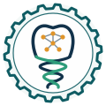

# ICARB-D — International Consortium for AI, Robotics, and Bioinformatics in Dentistry



ICARB-D brings dental schools and researchers together to **measure, build and share** artificial intelligence, robotics and bioinformatics in oral-health education, research and care.

- Website: https://igoralves1.github.io/ICARB-D/
- Questionnaire information page: https://igoralves1.github.io/ICARB-D/form.html

## Founders

**Dr. Marcel Montezuma**: DDS (UNIFOR, Brazil) · Master in Oral Science (University of Rochester, USA) · Fellowship in Digital Dentistry (University of Rochester, USA) · Advanced Education in General Dentistry, AEGD (University of Rochester, USA)

**Dr. Igor Lemos Alves**: DDS (UFBA, Brazil) · Residency in Social Medicine and Family Health (ISC/UFBA, Brazil) · Specialist in Geographic Information Systems (UnB, Brazil) · Software Development and Information Management (College, Canada) · Graduate studies in Bioinformatics (UQAM, Canada)

**Dr. Wander Kobayashi**: DDS (USP, Brazil, 1994) · Specialization in Implant Dentistry (APCD, Brazil, 2002) · Master's Degree in Implant Dentistry (UNISA, Brazil, 2007) · Specialization in Oral and Maxillofacial Surgery and Traumatology (SOESP, Brazil, 2014)

## The logo

A tooth (dentistry) whose crown holds a small neural network (AI) and whose roots form a DNA double helix (bioinformatics), set inside a gear (robotics).

## First study (2026): AI Readiness in Dental Schools

A department- and course-level assessment of AI integration in dental education in Canada, the United States, Brazil, China and India. It covers infrastructure, human resources, AI teaching hours by topic (including programming and model development), generative AI, governance and sustainability.

- Questionnaire app, codebook and analysis: https://github.com/igoralves1/AI-assessment-DS-2026
- Respondents enter their XXX-XXX access code on the form page; it opens the questionnaire with the code filled in.
- The research team opens the questionnaire's `#/admin` page with the admin code (kept privately, not in this repository).

## Site structure

```
index.html        landing page: about, mission, three domains, countries, first study
form.html         purpose of the questionnaire, how it works, expected results, code entry
assets/logo.svg   logo (also the favicon)
assets/styles.css shared styles (light and dark mode)
```

Plain HTML and CSS, no build step. GitHub Pages serves the `main` branch.
